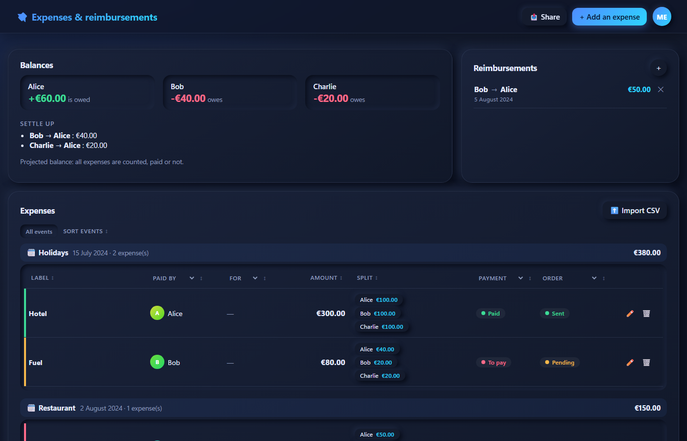

# Expenses & reimbursements

Shared expense splitting app: static (GitHub Pages), [Alpine.js](https://alpinejs.dev) + ES modules, storage and authentication with [Supabase](https://supabase.com) (OrioleDB).

Site: https://tdouillard.github.io/custom-expenses-app/ (branch `dev`, folder `/`).

## Overview

**Main features:**
- 📊 **Balances**: tracks who is owed and who owes, with suggested reimbursements
- 💸 **Expenses table**: grouped by event, sortable, filterable, with payment and order status
- 👥 **Reimbursements**: record the transfers that were made
- 📤 **Sharing**: copy a summary of the dashboard to paste into Signal, WhatsApp, Discord…
- 🔐 **Fine-grained access**: each event can be shared with specific users
- 🌐 **Languages**: English (default), French and German, switchable from the user menu

## Structure

- `index.html`: the page, assembles the components (`data-include`).
- `src/components/<name>/`: one folder per component (`.html`, `.js`, `.css`).
- `src/core/`: pure logic (calculations, filters, CSV, forms, translation helper `i18n.js`), no DOM.
- `src/i18n/`: translation dictionaries (`en.js`, `fr.js`, `de.js`). English is the reference; add a language by copying `en.js` and registering it in `src/core/i18n.js`.
- `src/config/`: table columns and collections (members, events), which drive the generic rendering. Labels are translation keys.
- `src/services/`: Supabase client (fetch) and state repository.
- `src/stores/`: Alpine stores (auth, data, admin, i18n).
- `supabase/schema.sql`: shared tables (`profiles`, `members`, `events`, `event_access`, `expenses`, `settlements`) + RLS.
- No HTML in the JS; no build step.

## Languages

- The interface is in **English** by default.
- Pick **French** or **German** from the language selector in the user menu (top right), or on the sign-in page.
- The choice is remembered on the device. When signed in, it is also saved to your account profile and applies on your other devices.
- Dates and amounts follow the selected language (for example `€12.50`, `12 May 2024`, `12,50 €`, `12. Mai 2024`).
- Text in templates uses `x-text="$t('key')"`; in JavaScript, use `t('key', { name })` from `src/core/i18n.js`. Missing keys fall back to English.
- CSV import accepts column headers in French, English and German (`Cadeau`/`Gift`/`Bezeichnung`, `Montant`/`Amount`/`Betrag`, and so on).

## Setup

1. Create `.env` (see `.env.example`) with `SUPABASE_URL`, the publishable key and `SUPABASE_DB_PASSWORD`.
2. `npm install`
3. `npm run config`: generates `config.js` (URL + publishable key only, committed).
4. `npm run db:setup`: applies `supabase/schema.sql`.
5. `npm start`, then open http://localhost:3003.

The database password is only used by the local scripts; it is never sent to the browser or committed.

To import existing data (the account must already exist): `npm run db:import -- <email> [state.json]`.

## Shared access and administration

- Each event (and its expenses) is only visible to users who were granted access; administrators see everything. The author of an event automatically has access to it.
- Members and reimbursements are shared by all signed-in users.
- The **Administration** tab (visible to administrators) manages roles, access per event, and lets you create / rename / delete events.
- First administrator: in the Supabase SQL editor, run `update public.profiles set is_admin = true where email = '<email>';`.
- Migration: running `npm run db:setup` once migrates the old `app_state` rows (their owners become administrators). The `app_state` table is no longer used and can be dropped afterwards.

## Authentication

The app only offers sign-in: accounts are created directly in Supabase (Authentication → Users → Add user). To prevent any sign-up through the API, also disable *Allow new users to sign up* in Supabase → Authentication → Sign In / Providers → Email.

In Supabase → Authentication → URL Configuration, add the GitHub Pages site URL as *Site URL* / *Redirect URL*.

## Tests

- `npm test`: unit tests (`node --test`).
- `npm run test:e2e`: Playwright (simulated Supabase). First time: `npx playwright install chromium`.
